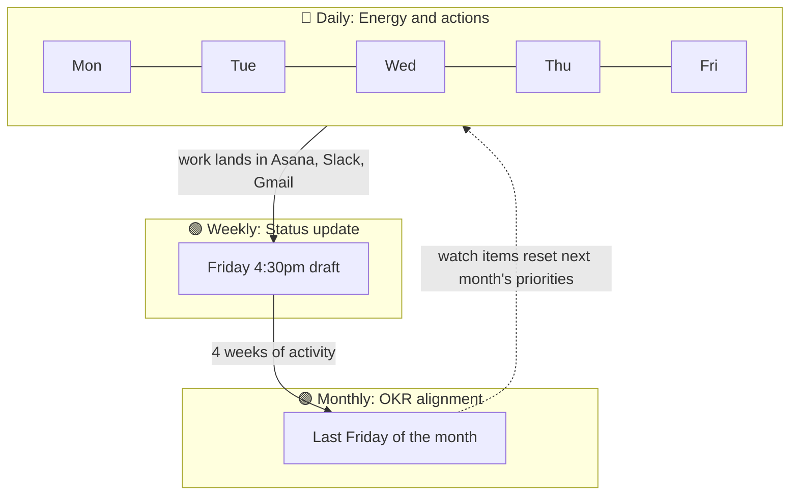

# WaysofWork
Various Skills and Flows I leverage to drive personal productivity
# My Operating Rhythm

Three skills that run at three cadences. Each one answers a different question, and each rolls up the work of the layer before it.

| Cadence | Skill | Question it answers | Runs in |
|---|---|---|---|
| 🔵 Daily | Next Tasks & Energy Plan | What should I work on right now, and when? | Glean agent |
| 🟢 Weekly | Weekly Status Update | What did I get done, and what's still open? | Claude skill (scheduled) |
| 🟣 Monthly | OKR Alignment Report | Did that work move my OKRs? | Glean agent + Google Drive |

See `flow-diagram.svg` for the visual.

---

## How the layers connect

The skills don't pass files to each other. Each one reads the underlying activity in your tools, so the link is the work itself:

1. **Daily → Weekly.** The daily plan shapes what you do. What you do shows up in Asana, Slack and Gmail. The weekly update reads those three sources.
2. **Weekly → Monthly.** Four weekly updates cover the same ground the OKR report reads at month end. Use the weekly drafts as a sense-check on the OKR mapping.
3. **Monthly → Daily.** Watch items and OKRs with no activity tell you what to pull into "Do now" or "Schedule" next month.

---

## 🔵 Daily: Next Tasks & Energy Plan

**When:** Start of each working day, and again after a heavy meeting block if priorities shift.

**Reads (via Glean):**

| Source | Window |
|---|---|
| Google Calendar | Now to +7 days |
| Meeting transcripts | Last 30 days |
| Confluence, Slack, Google Drive | Last 7 days |
| Jira (assigned, created, watched) | Open / last 7 days |
| Asana | Last 7 days and currently assigned |

**You get:**
- Immediate tasks sorted into Do now, Schedule, Delegate and Eliminate
- An Energy & Context Switching Plan for the rest of the day (Time | Activity | Energy mode)

**Links:** [Glean agent](https://app.glean.com/chat/agents/48276e0d1d2f49d29d67c13e62c9fd97), [Confluence](https://xero.atlassian.net/wiki/x/2QGuPT8)

---

## 🟢 Weekly: Weekly Status Update

**When:** Fridays, 4:30pm local. Task ID `weekly-status-draft`, cron `30 16 * * 5`. Runs only while the Claude app is open.

**Reads (via Claude connectors):** Asana, Slack and Gmail, last 7 days.

**You get:** A draft with Completed, In Progress, Decisions / Alignment, Open / Needs Follow-through and Next Week. Max 12 bullets. Nothing is sent until you say so.

**Carry-over:** Anything in Open / Needs Follow-through should appear in Monday's daily plan. If it doesn't, check Asana for a missing task or due date.

---

## 🟣 Monthly: OKR Alignment Report

**When:** Last Friday of the month, after the weekly update.

**Reads (via Glean):** Drive, email, calendar, Slack and Jira. Loads OKR context from your **My OKRs** doc.

**Maps to:**

| OKR | Objective |
|---|---|
| O5 | Drive Payments revenue |
| O10 | Deepen AU |
| O11 | PXL / Transform partner sales channel |
| O14 | Seamless delivery in a matrix |

**You get:**
- A Google Doc report: summary, top 3 contributions, all activities mapped, watch items, OKR coverage
- A row appended to the quarterly Google Sheet log

**Link:** [Glean agent](https://app.glean.com/chat/agents/ff811c994ad64b108fc9270529b2f660)

---

## A typical month

| Week | Mon–Thu | Friday |
|---|---|---|
| 1 | 🔵 Daily plan | 🔵 Daily plan, 🟢 Weekly update |
| 2 | 🔵 Daily plan | 🔵 Daily plan, 🟢 Weekly update |
| 3 | 🔵 Daily plan | 🔵 Daily plan, 🟢 Weekly update |
| 4 (last) | 🔵 Daily plan | 🔵 Daily plan, 🟢 Weekly update, 🟣 OKR report |

Time cost is roughly a few minutes a day to review the plan, 10 minutes on Friday to edit and send the update, and 20 minutes at month end to review watch items.

---

## Changes needed to run OKR alignment monthly

The OKR agent and `SKILL.md` are currently built for a weekly run. To move it to monthly:

| Change | Where |
|---|---|
| Lookback from 7 days to the calendar month (or 30 days) | Gather step, query patterns (`updated:past_week` → past month) |
| "Week Ending" to "Month Ending" | Report template title and completion summary |
| Top 3 contributions may need to become top 5 for a full month | Mapping step |
| One Sheet row per month (3 per quarter, not ~13) | Quarterly log step |
| Schedule the agent for the last Friday of the month | Glean agent settings |

---

## Setup checklist

- [ ] Glean connector enabled in Claude (both Glean skills)
- [ ] Asana, Slack and Gmail connectors enabled (weekly skill)
- [ ] Google Drive connector enabled with write access (OKR report)
- [ ] Peak-energy hours stated once, so the daily plan stops assuming them
- [ ] Weekly task pre-approved via **Run now** so Friday runs don't pause
- [ ] My OKRs doc up to date for the current fiscal year

## Known gaps

- **Fallback OKRs are FY26.** Refresh them in the OKR skill for the current year.
- **Quarterly Sheet log.** The 6 Nov 2026 run didn't confirm the Sheet update. Check it after each run.
- **Asana and Miro in the OKR report.** Allowed as sources in the mapping, but there are no gather steps for them. Asana is covered daily and weekly, so adding it to the monthly gather would close the loop.
- **Permission-filtered results.** Empty results in any skill can mean no access, not no activity.

## Files

| File | Purpose |
|---|---|
| `README.md` | This file |
| `flow-diagram.svg` | Visual of the daily, weekly and monthly flow |
| `1. StartofDay` | Daily skill and README |
| `3. Weeklyupdate` | Weekly skill and README |
| `2. OKR-Alignment` | Monthly skill and README |
